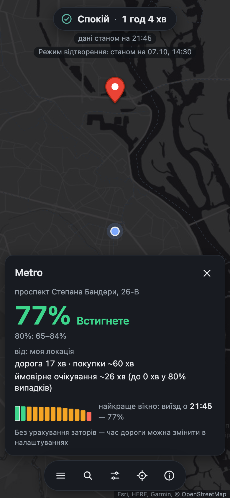
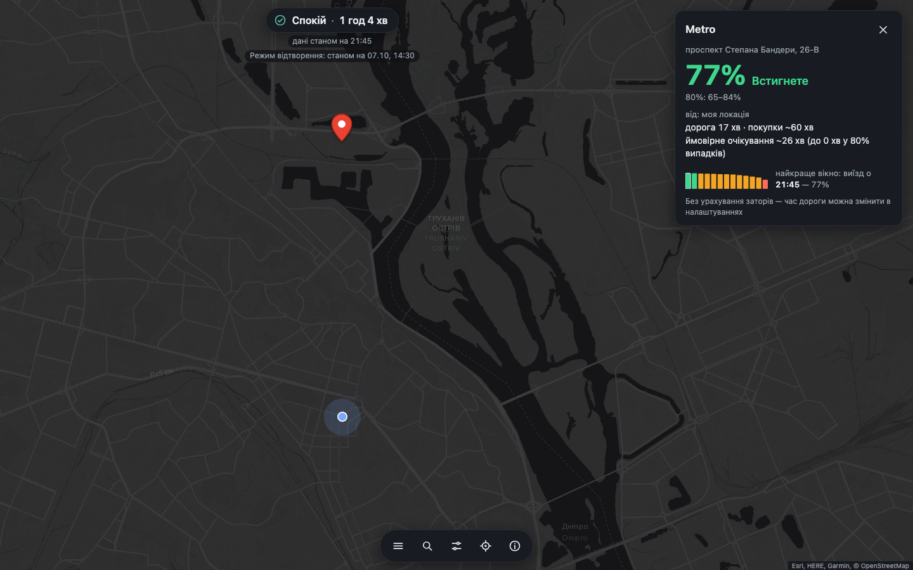

# Встигну?

**Карта Києва, яка за кілька секунд каже, який шанс доїхати в Metro, закупитись і оплатити до початку
повітряної тривоги** — з урахуванням вашої дороги, часу на покупки й того, скільки ви готові чекати відбою.

<p>


</p>

```bash
make setup     # uv sync --frozen; перевірка node/deno і docker
make demo      # режим відтворення на закомічених даних — без Telegram
open http://127.0.0.1:8000
```

`make demo` відтворює 07.10, 14:30 за Києвом (спокій, тривога закінчилась годину тому); `make demo-alert` — 16:45 того ж
дня, 16 хв після початку тривоги. Модель для демо навчається **лише на даних, відомих до цього моменту** (≈ 15–20 с).
Тести: `make test` (pytest + `node --test`, без node — `deno test`).

## Результати

Тест — 13.09…11.10.2026 (29 днів, 213 стартів тривог), модель не бачила його під час навчання й вибору параметрів.
Усі числа — з [`reports/model_eval.md`](reports/model_eval.md) і [`data/processed/model_card.json`](data/processed/model_card.json).

**Продуктовий бектест** (2000 випадкових поїздок у тестовому місяці, правила як у застосунку):
- калібрування: коли ми кажемо **~71%, встигали в ~74%** поїздок (дециль 9: прогноз 0.71 / факт 0.74);
- BSS сценаріїв M1a проти бази B1 (14-денна частота тривог) = **0.060, 95% CI [0.013, 0.111]** (bootstrap по днях).

**Прогноз старту тривоги, BSS M1a vs B1 з 95% CI:**

| горизонт | 15 хв | 30 хв | 60 хв | 120 хв |
|---|---|---|---|---|
| BSS M1a | 0.009 [−0.003, 0.022] | 0.023 [−0.003, 0.050] | **0.055 [0.006, 0.105]** | 0.088 [−0.011, 0.173] |

Виграш невеликий; значущий (CI не захоплює 0) — лише на 60 хв.

**Дрони не допомогли — чесний негативний результат.** Аблація: модель з 26 дрон-ознаками (M1b) проти M1a, ΔBrier
M1b − M1a: +0.0006 [−0.0078, 0.0083] на 30 хв, +0.0037 [−0.0076, 0.0134] на 60 хв — на жодному горизонті немає
значущої різниці. На валідації M1b була кращою (Brier 0.1704 проти 0.1848), але на тесті переоцінила силу сигналу:
у найвпевненішій групі на 60 хв обіцяла 0.94, а збулось 0.78. Тому в продукті M1a (історія тривог + час доби).
Модель руху дронів теж не пішла в продукт: курс фактично випадковий уже через ~8 хв
([`reports/drone_motion.md`](reports/drone_motion.md)).

Подробиці для користувача — сторінка «Про модель» (`/model.html`), усі числа там беруться з `/api/model-card`.

## Архітектура

```
 Telegram: UkraineAlarmSignal, air_alert_ua,        alerts.in.ua SITREP
 kudy_letyt, kpszsu, kyiv_nebo (tg-live, 1 сесія)    (sitrep-poll)
                 │                                         │
                 ▼                                         ▼
  data/live/{alerts,drones}.sqlite  ── журнали з known_at ──  data/live/sitrep.sqlite
                 │  (знімок db-snapshot / read-only mount)
                 ▼
  features_asof(t): лише рядки з known_at ≤ t   ──►  сітка 5 хв + мітки  (model_grid.parquet)
                 │
                 ▼
  B1 / M1a / M1b (логістичний hazard, 24 кроки × 5 хв)  +  Kaplan–Meier тривалості
                 │   nightly 04:00: ансамбль 5 × bootstrap по днях → model_final.pkl + model_card.json
                 ▼
  сценарії (5 × 200 на 120 хв, кожні 30 с)  ──►  симулятор поїздки  ──►  /api/estimate
                 │
                 ▼
  FastAPI 127.0.0.1:8000: /api/state, /api/estimate, /api/model-card, /api/health + статика web/
                 │
                 ▼
  web/ (Leaflet, без збірки): геолокація й маршрут — у браузері; на сервер ідуть лише хвилини
```

## Дані та знайдені проблеми

Мітка — старт тривоги м. Київ з волонтерського каналу єТривога: до 26.08 — CSV Vadimkin, далі — наш колектор.
Головне, що знайшли ([`reports/data_quality.md`](reports/data_quality.md)):
- офіційний CSV містить історію двічі — 38.04% рядків точні дублікати;
- офіційний канал тривог замовк 2026-09-07 → джерело міток змінили на волонтерський канал (одне джерело на весь період);
- з 17.08 змінився режим: 2.06 → 5.09 → 7.34 стартів на добу (до 17.08 / навчання / тест) — навчаємо лише з 10.08,
  тривалості — з 17.08.

Деталі фази 1 (джерела, шви, політика чистки) — нижче, у розділі «Дані (фаза 1)».

## Як ми уникали витоку

- Кожен запис має `start_known_at` / `end_known_at` — коли про подію стало відомо; ознаки в момент t рахуються лише
  з рядків, відомих до t (`features_asof`).
- Тест на витік: ознаки для 200 випадкових t, перераховані з джерел, обрізаних до t, мають збігтися з сіткою
  ([`reports/model_lift.md`](reports/model_lift.md)).
- Walk-forward з purge: модель доби d навчається лише на t з t + 120 хв ≤ 00:00 d; тест використано один раз.
- Replay (`make demo`): джерела щоразу обрізаються по `known_at ≤ годинник`, модель навчена лише на мітках, закритих
  до моменту відтворення; це перевіряє [`tests/test_replay.py`](tests/test_replay.py).

## Процес з AI

Кожна фаза — окреме ТЗ для Claude Code: [`docs/tasks/`](docs/tasks/) (фази 1–5). Що змінювали після критики:
- офіційний канал помер → джерело міток змінено на волонтерський, з перевіркою збігу стартів;
- горизонт прогнозу скорочено з 180 до 120 хв ([ТЗ фази 5](docs/tasks/phase5_mvp_task.md));
- «броунівський рух» дронів замінили калібрувальною моделлю руху й аблацією проти базових
  ([`reports/drone_motion.md`](reports/drone_motion.md), [`reports/model_eval.md`](reports/model_eval.md));
- самооцінку парсера замінили незалежною сліпою розміткою hold-out
  ([`reports/drone_parse_eval_holdout.md`](reports/drone_parse_eval_holdout.md)).

## Live-режим

```bash
cp .env.example .env    # TG_API_ID / TG_API_HASH з my.telegram.org
make login              # інтерактивно; сесія — у ~/.config/airalert/ (600), поза репо
make up                 # collector, sitrep, api, nightly; чекає, поки /api/health відповість
make ps / make logs / make down
make model              # перенавчити з живої БД (знімок усередині колектора)
make snapshot           # копії всіх live-БД у data/work/backup/<дата>/, ротація 7 днів
make deploy HOST=user@host DIR=/opt/airalert
```

Холодний старт: на порожньому `data/live` API не падає — `/api/state` віддає `status: "unknown"`, сайт показує
«Немає свіжих даних», поки колектор не наздожене. Якщо навченої моделі ще немає (`model_final.pkl` у `.gitignore`),
`make up` спершу запускає `make model-fallback` — модель на закомічених даних у `data/work/replay/latest/`, API пише
warning і переходить на нічну модель, щойно `nightly` її створить. `GET /api/health` → `{code_sha, model_updated_at,
sources: {alerts, drones, sitrep: {data_as_of, ok}}}`. Час повного холодного циклу (`make down && rm -rf data/live/* &&
make up` → живий статус) на ноутбуці ще не заміряно.

## Структура репо

```
src/airalert/   tg/ (колектор, парсер), sitrep/, drones/ (парсер, газетир, рух), model/ (ознаки, моделі, сценарії),
                api/ (FastAPI, live, replay), cli.py (airalert …)
web/            фронтенд без збірки: index.html, model.html, js/, css/, i18n/uk.json
data/processed/ закомічені артефакти: alerts.parquet, drone_mentions.parquet, model_grid.parquet, model_eval/, model_card.json
reports/        звіти якості даних, парсера, моделі
tests/          pytest; tests/web/*.test.mjs — node --test
docs/tasks/     ТЗ фаз 1–5; docs/screenshots/
```

## Ліцензії й атрибуція

Датасет і `states.json` — Vadimkin (MIT, [`LICENSES/vadimkin-MIT.txt`](LICENSES/vadimkin-MIT.txt)); газетир — GeoNames
(CC BY 4.0, [`LICENSES/geonames-CC-BY-4.0.txt`](LICENSES/geonames-CC-BY-4.0.txt)); магазини й райони — OpenStreetMap
(ODbL, [`LICENSES/OSM-ODbL.txt`](LICENSES/OSM-ODbL.txt)); підложка — Esri.

## Обмеження й наступні кроки

- Тест — один місяць з вищою інтенсивністю тривог, ніж у навчанні; CI широкі.
- Рекалібрування дрон-блоку (isotonic / сильніша L2) на свіжому вікні з чесною оцінкою на новому тесті.
- Районні тривоги з SITREP як ознака — після ≥ 3 тижнів історії.
- McDonald's і режим «пішки», англійська версія.

---

# Дані (фаза 1)

### Джерела

| Джерело | Що це | Період у фінальному наборі |
|---|---|---|
| `dataset_official` | [Vadimkin/ukrainian-air-raid-sirens-dataset](https://github.com/Vadimkin/ukrainian-air-raid-sirens-dataset) (MIT), `official_data_en.csv`, після дедупу | 2022-03-15 … 2026-08-26 |
| `tg_official` | Telegram [@air_alert_ua](https://t.me/air_alert_ua) («Повітряна Тривога»), наш парсер | 2026-08-26 … 2026-09-07, крім збою 08-29…09-02 |
| `tg_volunteer` | Telegram [@UkraineAlarmSignal](https://t.me/UkraineAlarmSignal) (єТривога), наш парсер | збій 08-29…09-02 і з 2026-09-07 06:09 UTC до зараз |
| `dataset_volunteer` | `volunteer_data_en.csv` того ж репо | тільки для перехресної перевірки (№8) |

Шов датасет → Telegram: `2026-08-26T00:00Z` (за `started_at`). Перемикання між Telegram-джерелами — за вікнами
мовчання офіційного каналу (> 6 год), вони записані в `data/processed/manifest.json`.

### Знайдені проблеми

1. **Офіційний CSV містить історію двічі.** Перші 113 911 рядків (до 2026-01-25) дописані у файл ще раз одним
   блоком: 299 275 → 185 430 рядків після `drop_duplicates()`, Київ 4141 → 2267.
2. **Офіційний CSV застарів, бо помер сам канал.** 2026-08-30 `air_alert_ua` оголосив, що «з технічних причин
   тимчасово не працює публікація повідомлень» (рекомендують API api.ukrainealarm.com); 08-31…09-01 — жодного
   повідомлення, після 2026-09-07 06:09 UTC — тиша. Тому і датасет закінчується 2026-09-07.
3. **Прихована імпутація автора.** Незакрита тривога закривається як `start + 1h` (255 рядків рівно по 3600 с —
   прапорець `end_imputed`), а повторний старт < 3 год затирає попередній. Під час збою 08-29…09-02 це дало
   4-денні «тривоги» в датасеті.
4. **Парсер автора не відрізняє загрози від тривог.** У `air_alert_ua` є «🔴🔴 Загроза ударних БпЛА/КАБ/балістики»,
   «🟠 УВАГА!!! …», «Загроза артобстрілу», «вуличні бої», «радіаційна небезпека» — автор рахує 🔴 як старт
   тривоги, а «Відбій загрози …» як її кінець. Наш парсер розрізняє `alert_type`.
5. **Волонтерський CSV занижує тривалість** через пізні старти (2025: у 37% тривог Києва старт пізніший за
   офіційний > 2 хв, години 740 vs 419). Причина — парсер автора за ключовими словами: **наш** парсер того самого
   каналу збігається з офіційним до ~10–15 с (перевірка №9, деталі у звіті).
6. **єТривога змінила формат:** з 2026-09-06 замість 🚨 — рівні «🟡 Жовтий» / «🔴 Червоний рівень тривоги»;
   з 2026-09-25 списки місць мають маркери «• »; райони, перейменовані 2024 р. (Берестинський, Володимирський,
   Шептицький), мапляться на назви датасету (Krasnohradskyi …).
7. Дрібне: 2 нульові/від'ємні тривалості (official), 6 (volunteer); 3 дні без записів (08-30…09-01 — збій каналу).

### Політика чистки

- Точні дублікати видаляються; перекриття однієї локації зливаються (прапорець `merged_overlap`).
- **Нічого не домальовуємо.** Незакрита тривога = `finished_at IS NULL`. Інтервали, які обірвав збій джерела,
  лишаються без кінця з прапорцем `source_gap` і у фінальний набір не потрапляють — замість них береться копія
  з іншого каналу з реальним кінцем.
- Аномалії — прапорцями, не перезаписом: `dup_start` (повторний старт без відбою), `open_over_24h`,
  `end_imputed` / `naive_end` (імпутація в датасетах), `closed_by_air_raid_end` (загрозу закрив загальний відбій).
  Нерозпізнані повідомлення й невідомі місця → таблиця `parse_errors`.
- **Без витоку:** кожен рядок має `start_known_at` / `end_known_at` — коли ми про подію дізналися. Для історії
  (датасет, backfill) це час публікації, для live — `received_at`. Тексти повідомлень зберігаються такими, як
  ми їх побачили вперше; редагування — окремо в `message_edits`.

### `data/processed/alerts.parquet`

`granularity` (`raw` — інтервали як є; `oblast_union` — «тривога десь в області», union усіх рівнів, тільки
повітряні тривоги), `location` (`Kyiv City`, `Kyivska oblast`, …), `level`, `raion`, `hromada`, `alert_type`
(`air_raid`, `air_raid_red`, `drones`, `kab`, `ballistic`, `missile`, `artillery`, `street_fight`, `radiation`,
`threat_other`), `started_at`, `finished_at`, `start_known_at`, `end_known_at` (UTC), `source`, `flags`,
`start_msg_id`, `end_msg_id`. Поруч — `manifest.json` (коміти, вікна збоїв, кількості рядків).

## Як запустити фазу 1

```bash
uv sync                                   # Python 3.12
uv run airalert fetch-dataset             # clone Vadimkin у data/raw/
uv run airalert validate-dataset          # перевірки 1–8 → reports/data_quality.{md,json}
uv run pytest && uv run ruff check .      # офлайн-тести
```

Telegram (потрібні `TG_API_ID`/`TG_API_HASH` з my.telegram.org у `.env`, див. `.env.example`):

```bash
uv run airalert tg-login                  # ІНТЕРАКТИВНО, людина; QR-код (або --method code)
uv run airalert tg-backfill --since 2026-08-25 --channel air_alert_ua
uv run airalert tg-backfill --since 2026-08-25 --channel UkraineAlarmSignal
uv run airalert rebuild-alerts --channel UkraineAlarmSignal   # raw_messages → alerts (детерміновано)
uv run airalert build                     # alerts.parquet + manifest + повний звіт (перевірки 1–13)
```

Сесія Telethon дає повний доступ до акаунта: вона лежить **поза репозиторієм** (`~/.config/airalert/`, права
600), `*.session` і `.env` — у `.gitignore`. Колектор лише читає публічні канали: нічого не надсилає й ні до чого
не приєднується. Оновлення в реальному часі Telegram надсилає тільки для каналів, на які акаунт підписаний;
для решти колектор опитує канал кожні 15 с.

### Живий колектор у Docker

```bash
export AIRALERT_UID=$(id -u) AIRALERT_GID=$(id -g)
docker compose up -d --build collector    # tg-live: дочитує пропущене з max(msg_id), потім слухає
docker compose ps                         # healthy = heartbeat свіжіший за 5 хв
AIRALERT_CODE_SHA=$(git rev-parse HEAD) docker compose run --rm tools build
```

Не-root, `read_only` + `tmpfs /tmp`, жодних портів, `cap_drop: ALL`, `restart: unless-stopped`; змонтовані лише
`data/live` і каталог сесії. Поки колектор працює, не запускайте Telegram-команди на хості з тією ж сесією, а
команди, що читають `data/live/alerts.sqlite`, запускайте через `docker compose run --rm tools …` (SQLite у
Docker Desktop на macOS не можна безпечно ділити між хостом і контейнером).

## Фаза 4: модель, оцінка, API

Результати — `reports/model_eval.md` (аблація дронів, BSS з CI, калібрування, KM, продуктовий бектест) і
`data/processed/model_card.json`. Коротко: дрон-ознаки на тесті 09-13…10-11 не дали значущого виграшу, у продукті
M1a (історія тривог + час).

```bash
docker compose exec collector airalert db-snapshot --db alerts   # знімок для офлайн-кроків
uv run airalert model-features      # сітка 5 хв + мітки + ознаки, тест на витік -> reports/model_lift.md
uv run airalert model-eval          # C на 08-24…09-12, walk-forward на тесті, KM, бектест -> reports/model_eval.md
uv run airalert model-fit --no-rebuild   # фінальний ансамбль (5 bootstrap-рефітів) + model_card.json
uv run airalert serve               # http://127.0.0.1:8000 (потрібен web/ з фронтенду)
```

У Docker: `docker compose --profile serve up -d api nightly`. `api` слухає лише `127.0.0.1:8000`, `nightly`
перенавчає модель о 04:00 за Києвом; API підхоплює нові файли без перезапуску. Обидва сервіси монтують
`data/live` **лише для читання**: так вони фізично не можуть зачепити WAL колектора.

API (усі часи ISO 8601 UTC; `Cache-Control: no-store`, крім model-card):
- `GET /api/state` — `{status, level, since, data_as_of, sources_ok}`; `level` береться з SITREP, якщо той свіжий,
  інакше з `air_raid_red` волонтерського каналу.
- `GET /api/scenarios` — 5 членів × 200 сценаріїв на 120 хв, оновлення кожні 30 с, ETag.
- `GET /api/estimate?travel=&depart_in=&shop_mean=&shop_sd=&wait_max=&open_delay=` — готова ймовірність встигнути
  (`{p, band, wait, curve, best, share_beyond, unsure, skill_bucket, …}`). Сюди надходять лише хвилини, без
  координат; query string не логується.
- `GET /api/health` — `{code_sha, model_updated_at, sources}` для моніторингу; `GET /api/model-card`, а на `/` — статика фронтенду.

Атрибуція: `states.json` і логіка хештегів — з репозиторію Vadimkin (MIT, `LICENSES/vadimkin-MIT.txt`).
