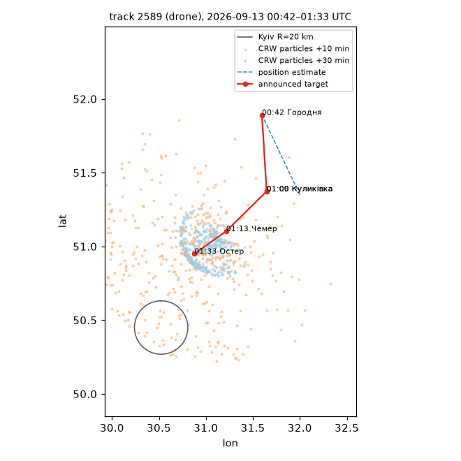
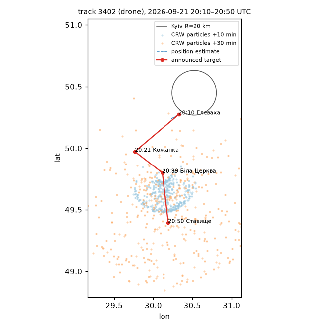
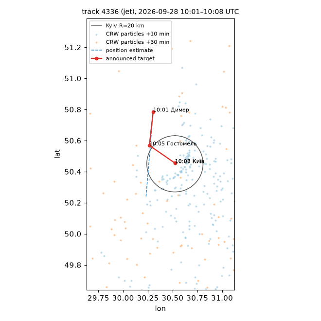
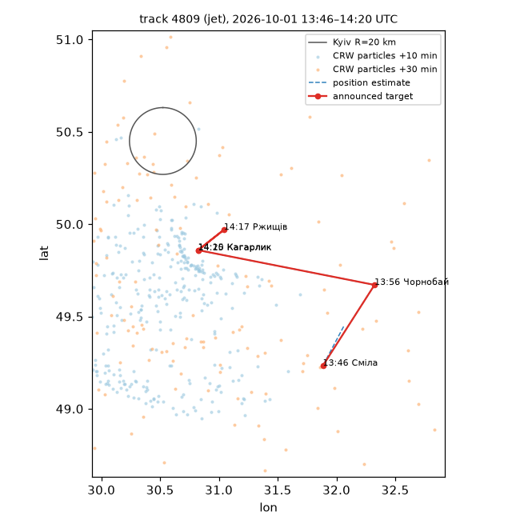
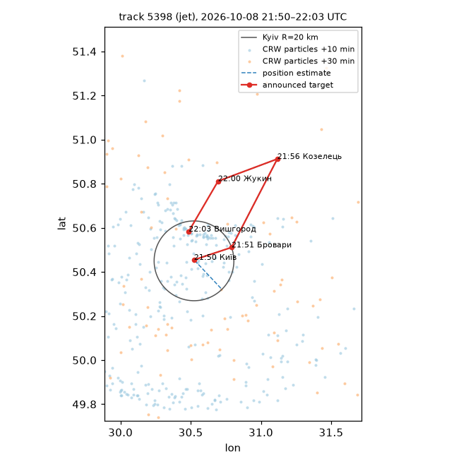

# Drone pseudo-tracks and the motion model

Generated 2026-10-12 12:13 UTC. Source: **kudy_letyt** only (kpszsu is auxiliary — parser recall on the hold-out is 0.66 raw), kinds `drone_jet` / `drone`, point places, late-edited history excluded.

## Pseudo-tracks (approximation)

Mention j continues track i if Δt ≤ 20 min, same speed class and the distance between the announced targets ≤ v_max·Δt + 30 km (v_max: jet 12.0, drone 4.0 km/min); greedy nearest-first, one mention per track per post, count carried; a track closes after 25 min. Position estimate = «повз X» if given, else the previous *different* target, else (first mention) the oblast centroid.

- observations: 24024, tracks: 5955, median track length 2
- **share of mentions in tracks of length ≥ 2: 91.0%**
- track duration, min: median 10, 90% 58, max 261 — long tracks are mostly several drones of a dense attack chained together (a known weakness of ID-less association)
- calibration pairs (consecutive observations with a changed target, Δt ≤ 20 min): 4631 (2026-08-10…09-12), validation: 6772 (2026-09-13…10-11)

Caveat: the channels never report the drone's position, only where it is heading. The pseudo-track glues posts by plausibility, so two drones in the same area can be merged; the «observed» point of a pair is the next announced target (as the task prescribes), a proxy that is typically tens of km ahead of the drone.

## Motion model

Correlated random walk: θ_{k+1} = θ_k + σ_θ·√Δt·ε (1-min steps), speed = v_class·exp(σ_v·ε) per particle (jet 10, drone 3 km/min), Monte Carlo; Gaussian observation noise σ_obs fitted per model. Grid MLE on the calibration period only.

**Fitted: σ_θ = 0.35 rad/√min, σ_v = 1.0.**

| σ_θ | σ_v | mean log-lik (cal) | σ_obs km |
|---|---|---|---|
| 0.35 | 1.0 | -10.205 | 30 |
| 0.35 | 0.75 | -10.217 | 30 |
| 0.5 | 1.0 | -10.232 | 30 |
| 0.5 | 0.75 | -10.235 | 30 |
| 0.2 | 1.0 | -10.246 | 30 |
| 0.35 | 0.5 | -10.246 | 30 |
| 0.5 | 0.5 | -10.247 | 30 |
| 0.5 | 0.35 | -10.263 | 30 |

## Validation (2026-09-13 … 2026-10-11)

| model | σ_obs km | mean log-lik per pair | target in 50% region | target in 80% region |
|---|---|---|---|---|
| crw (fitted) | 30 | -10.441 | 48.3% | 74.1% |
| line, no noise | 60 | -10.777 | 73.8% | 88.4% |
| stay | 60 | -10.988 | 57.9% | 82.6% |

## Conclusions

- The CRW is **better** than the straight line by +0.336 nats per pair on the validation period; «stays in place» is the worst.
- The fitted noise is large (σ_θ = 0.35 rad/√min ⇒ the course is essentially random after ~8 min): announced targets jump between posts and pseudo-tracks merge drones. Course information is useful for the first minutes only; at 15–120 min the prediction is close to diffusion around the current area — consistent with the alert-level lift decaying from 15 to 60 min.
- Coverage: the CRW's 50% / 80% regions contain the next target in 48% / 74% of the pairs — the model is somewhat over-confident at the median (the straight line looks better calibrated only because its fitted σ_obs is 60 km, i.e. very wide). Use p_reach as a ranking feature, not a calibrated probability.

## Example tracks (validation period, near Kyiv)

