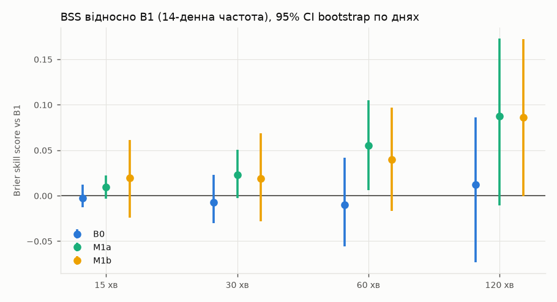
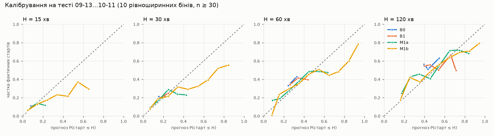

# Модель тривог у Києві: оцінка

Прогін 2026-10-12 15:38 UTC, код `6b59b31`. Тест: 29 днів (2026-09-13…10-11, дні за Києвом), 5610 спокійних моментів t. Тест використано один раз: для фінальних чисел нижче; C, ваги й відрізки обрано на 08-24…09-12.

## Коротко

- **Аблація дронів (головний результат):** M1b (+дрони) проти M1a (лише історія тривог + час): ΔBrier з 95% CI перетинає 0 на 4 з 4 горизонтів — **значущої різниці немає**. На валідації (08-24…09-12) M1b була кращою: середній Brier 0.170 vs 0.185; на тесті перевага не відтворилась.
- **У продукт іде M1a** (менший середній Brier на тесті з двох).
- Обидві логістичні моделі кращі за B1 (14-денна частота) за точковою оцінкою на всіх горизонтах; CI BSS відділений від 0 лише там, де вказано в таблиці.
- Тривалість (KM з 08-17) на тесті: max |прогноз − факт| = 0.067 (таблиця нижче).
- Продуктовий бектест: BSS M1a-сценаріїв vs B1-сценаріїв = 0.060 (95% CI 0.013…0.111).

## Дані й постановка

Мітка — старт тривоги м. Київ (єТривога; до 2026-08-26 CSV Vadimkin, далі наш UkraineAlarmSignal). Сітка 5 хв, прогноз лише в спокої, дискретний hazard на 24 кроки (120 хв). Ознаки as-of (known_at ≤ t), тест на витік 200/200 — див. `reports/model_lift.md`.

| період | днів | стартів | на добу | медіана тривалості, хв |
|---|---|---|---|---|
| before regime change (2026-06-01…08-16) | 77 | 159 | 2.06 | 20 |
| train/selection (08-10…09-12) | 34 | 173 | 5.09 | 30 |
| test (09-13…10-11) | 29 | 213 | 7.34 | 35 |
| after test (10-12…) | 1 | 2 | 2.00 | 67 |

Тест має на ~45% більше стартів на добу, ніж період навчання: нестаціонарність — головна загроза калібруванню.

## Моделі

- **B0** — константний hazard на крок (зважене середнє навчання).
- **B1** — λ = старти / години спокою за 14 днів до t; P(старт ≤ H) = 1 − e^(−λH).
- **M1a** — логістичний hazard, окрема L2-логрегресія на відрізок кроків {1–3, 4–6, 7–12, 13–24}, ознаки рівня тривог + час; C = 1.0.
- **M1b** — M1a + 26 дрон-ознак; C = 1.0.

Ваги за давністю (півперіод 14 днів), стандартизація всередині fold. Walk-forward: для кожної доби d тесту модель навчається на t з t + 120 хв ≤ 00:00 d (purge) і прогнозує всі спокійні t доби d; перенавчання щодоби.

Підбір C (валідація 08-24…09-12, перенавчання кожні 4 дні, середній Brier по H):

| C | M1a | M1b |
|---|---|---|
| 0.003 | 0.3745 | 0.3637 |
| 0.01 | 0.2808 | 0.2641 |
| 0.03 | 0.2264 | 0.2067 |
| 0.1 | 0.1993 | 0.1800 |
| 0.3 | 0.1887 | 0.1726 |
| 1.0 | 0.1848 | 0.1704 |

⚠️ Обране C = 1.0 — край сітки. Сітку не розширював після того, як побачив тест (правило «тест один раз»).

## Метрики на тесті

| H, хв | модель | n | частка стартів | середній прогноз | Brier | log loss | BSS vs B1 |
|---|---|---|---|---|---|---|---|
| 15 | B0 | 5610 | 0.111 | 0.080 | 0.0992 | 0.3523 | -0.003 |
| 15 | B1 | 5610 | 0.111 | 0.102 | 0.0990 | 0.3506 | 0.000 |
| 15 | M1a | 5610 | 0.111 | 0.109 | 0.0981 | 0.3444 | 0.009 |
| 15 | M1b | 5610 | 0.111 | 0.132 | 0.0970 | 0.3325 | 0.019 |
| 30 | B0 | 5610 | 0.214 | 0.153 | 0.1707 | 0.5280 | -0.007 |
| 30 | B1 | 5610 | 0.214 | 0.192 | 0.1695 | 0.5236 | 0.000 |
| 30 | M1a | 5610 | 0.214 | 0.209 | 0.1656 | 0.5097 | 0.023 |
| 30 | M1b | 5610 | 0.214 | 0.242 | 0.1662 | 0.5074 | 0.019 |
| 60 | B0 | 5610 | 0.376 | 0.282 | 0.2407 | 0.6763 | -0.010 |
| 60 | B1 | 5610 | 0.376 | 0.345 | 0.2383 | 0.6706 | 0.000 |
| 60 | M1a | 5610 | 0.376 | 0.368 | 0.2252 | 0.6414 | 0.055 |
| 60 | M1b | 5610 | 0.376 | 0.399 | 0.2288 | 0.6502 | 0.040 |
| 120 | B0 | 5610 | 0.573 | 0.483 | 0.2503 | 0.6939 | 0.012 |
| 120 | B1 | 5610 | 0.573 | 0.564 | 0.2533 | 0.7013 | 0.000 |
| 120 | M1a | 5610 | 0.573 | 0.564 | 0.2312 | 0.6581 | 0.088 |
| 120 | M1b | 5610 | 0.573 | 0.594 | 0.2315 | 0.6649 | 0.086 |

### BSS vs B1 з 95% CI (bootstrap по днях, 1000)

| H, хв | B0 | M1a | M1b |
|---|---|---|---|
| 15 | -0.003 [-0.013, 0.012] | 0.009 [-0.003, 0.022] | 0.019 [-0.024, 0.062] |
| 30 | -0.007 [-0.030, 0.023] | 0.023 [-0.003, 0.050] | 0.019 [-0.028, 0.069] |
| 60 | -0.010 [-0.056, 0.042] | 0.055 [0.006, 0.105] | 0.040 [-0.016, 0.097] |
| 120 | 0.012 [-0.073, 0.086] | 0.088 [-0.011, 0.173] | 0.086 [-0.001, 0.172] |

### ΔBrier з 95% CI (від'ємне — перша модель краща)

| порівняння | H=15 | H=30 | H=60 | H=120 |
|---|---|---|---|---|
| M1b − M1a | -0.0010 [-0.0057, 0.0031] | 0.0006 [-0.0078, 0.0083] | 0.0037 [-0.0076, 0.0134] | 0.0003 [-0.0114, 0.0109] |
| M1b − B1 | -0.0019 [-0.0065, 0.0021] | -0.0032 [-0.0123, 0.0047] | -0.0094 [-0.0239, 0.0039] | -0.0219 [-0.0444, 0.0002] |
| M1a − B1 | -0.0009 [-0.0021, 0.0003] | -0.0038 [-0.0083, 0.0004] | -0.0131 [-0.0253, -0.0015] | -0.0222 [-0.0461, 0.0025] |

## Калібрування

Середній прогноз vs фактична частка (10 рівноширинних бінів) — у `data/processed/model_eval/calibration.csv`.

Найвищий бін (n ≥ 30) кожної моделі — де модель найвпевненіша:

| H, хв | M1a: прогноз → факт (n) | M1b: прогноз → факт (n) |
|---|---|---|
| 15 | 0.22 → 0.12 (190) | 0.65 → 0.29 (34) |
| 30 | 0.43 → 0.23 (74) | 0.85 → 0.56 (54) |
| 60 | 0.63 → 0.47 (274) | 0.94 → 0.78 (64) |
| 120 | 0.84 → 0.68 (494) | 0.94 → 0.79 (368) |

Обидві моделі у верхніх бінах переоцінюють; M1b розтягує прогнози ширше, і розрив у неї більший: дрон-сигнал має правильний напрям, проте його сила, вивчена на 08-10…09-12, на тесті переоцінена — це й з'їдає виграш у Brier. Природний наступний крок (не зроблено, бо вимагав би вибору на тесті) — рекалібрування/сильніша регуляризація дрон-блоку, обрані на свіжому вікні.

## Коефіцієнти дрон-ознак M1b по відрізках кроків

Стандартизовані коефіцієнти моделі першої тестової доби (навчання 08-10…09-12). Ознаки сильно корельовані (кільця 15/30 хв, kudy_letyt/kpszsu), тож знаки окремих коефіцієнтів нестабільні; дивитись на групу.

| ознака | k1-3 | k4-6 | k7-12 | k13-24 |
|---|---|---|---|---|
| n_ring30_15m | -0.07 | -0.04 | -0.06 | -0.17 |
| n_ring80_15m | 0.30 | -0.07 | -0.09 | 0.12 |
| n_ring150_15m | -0.03 | 0.28 | -0.14 | -0.05 |
| n_jet_ring150_15m | 0.00 | 0.14 | 0.44 | -0.11 |
| min_dist_km_15m | -0.47 | -0.46 | 0.20 | 0.07 |
| n_ring150_30m | 0.31 | -0.14 | 0.06 | -0.04 |
| kps_n_jet_ring150_30m | 0.47 | 0.37 | 0.06 | 0.25 |
| kps_min_dist_km_30m | -0.24 | -0.25 | -0.35 | -0.00 |
| kyiv_nebo_any_10m | 0.10 | 0.02 | -0.11 | 0.01 |
| missile_any_30m | 0.10 | 0.04 | 0.02 | 0.18 |

Повна таблиця: `data/processed/model_eval/coefs_M1b.csv`.

## Тривалість тривоги (Kaplan–Meier)

Медіани (non-naive): до 08-17 — 20 хв, навчання — 35 хв, тест — 35 хв: **тривалості не стабільні** (ТЗ припускало протилежне), тому KM будується з 2026-08-17 (рішення за даними до тесту). naive=True → цензура на 30 хв.

KM 08-17…09-12: n = 160, медіана 37 хв. Перевірка на тривогах тесту (P(відбій ≤ e + x | триває e)):

| KM з | e, хв | x, хв | n | прогноз | факт | Brier |
|---|---|---|---|---|---|---|
| 08-17 | 0 | 15 | 213 | 0.212 | 0.258 | 0.194 |
| 08-17 | 0 | 30 | 213 | 0.463 | 0.437 | 0.247 |
| 08-17 | 0 | 60 | 213 | 0.657 | 0.676 | 0.219 |
| 08-17 | 10 | 15 | 180 | 0.300 | 0.261 | 0.194 |
| 08-17 | 10 | 30 | 180 | 0.447 | 0.461 | 0.249 |
| 08-17 | 10 | 60 | 180 | 0.647 | 0.672 | 0.221 |
| 08-17 | 30 | 15 | 120 | 0.200 | 0.267 | 0.200 |
| 08-17 | 30 | 30 | 120 | 0.362 | 0.425 | 0.248 |
| 08-17 | 30 | 60 | 120 | 0.612 | 0.633 | 0.233 |
| 06-01 | 0 | 15 | 213 | 0.235 | 0.258 | 0.192 |
| 06-01 | 0 | 30 | 213 | 0.508 | 0.437 | 0.251 |
| 06-01 | 0 | 60 | 213 | 0.750 | 0.676 | 0.224 |
| 06-01 | 10 | 15 | 180 | 0.376 | 0.261 | 0.206 |
| 06-01 | 10 | 30 | 180 | 0.599 | 0.461 | 0.267 |
| 06-01 | 10 | 60 | 180 | 0.755 | 0.672 | 0.227 |
| 06-01 | 30 | 15 | 120 | 0.373 | 0.267 | 0.207 |
| 06-01 | 30 | 30 | 120 | 0.492 | 0.425 | 0.249 |
| 06-01 | 30 | 60 | 120 | 0.703 | 0.633 | 0.237 |

## Продуктовий бектест

2000 випадкових поїздок у тестовому вікні: t — випадкова точка сітки; дорога U(10, 40) хв; покупки N(60, 15) у [20, 120]; готовий чекати 0 або 15 хв; виїзд одразу. Передбачене P(успіх) — симулятор на 200 сценаріях, згенерованих на t (walk-forward модель доби, KM на тривогах до доби, λ = B1), факт — ті самі правила на справжніх тривогах. Наближення: один член ансамблю (смуга невизначеності тут не оцінюється); сценарії «за горизонтом» виключені з p, як у продукті.

Частка успішних поїздок: 0.453; з тривогою на момент t: 0.306.

| сценарії | Brier | середній P(успіх) |
|---|---|---|
| M1a | 0.2039 | 0.473 |
| B1 | 0.2169 | 0.481 |

BSS M1a vs B1 = 0.060, 95% CI (bootstrap по днях) 0.013…0.111.

Окремо: зараз спокій — n = 1388, Brier M1a 0.2282 vs B1 0.2470; зараз тривога — n = 612, Brier 0.1487 (сценарії однакові: перший інтервал з KM).

Калібрування P(успіх):

| бін | M1a: прогноз / факт (n) | B1: прогноз / факт (n) |
|---|---|---|
| 1 | 0.12 / 0.12 (200) | 0.12 / 0.12 (200) |
| 2 | 0.22 / 0.16 (197) | 0.22 / 0.15 (199) |
| 3 | 0.30 / 0.29 (201) | 0.33 / 0.31 (201) |
| 4 | 0.38 / 0.38 (202) | 0.44 / 0.56 (199) |
| 5 | 0.44 / 0.43 (200) | 0.50 / 0.50 (201) |
| 6 | 0.51 / 0.48 (199) | 0.54 / 0.45 (200) |
| 7 | 0.58 / 0.55 (200) | 0.60 / 0.58 (200) |
| 8 | 0.64 / 0.63 (197) | 0.65 / 0.57 (198) |
| 9 | 0.71 / 0.74 (199) | 0.68 / 0.66 (200) |
| 10 | 0.81 / 0.75 (205) | 0.73 / 0.63 (202) |

## Обмеження

- Тестове вікно — один місяць з іншою інтенсивністю, ніж навчання; CI широкі (29 днів).
- Районні тривоги Київщини та SITREP у модель не входять (немає в тесті).
- Сценарії: після першого старту hazard-модель не перезапускається; λ без добового циклу.
- Дрон-ознаки залежать від парсера (kudy_letyt P/R ≈ 0.97/0.96 на hold-out; kpszsu гірше).
